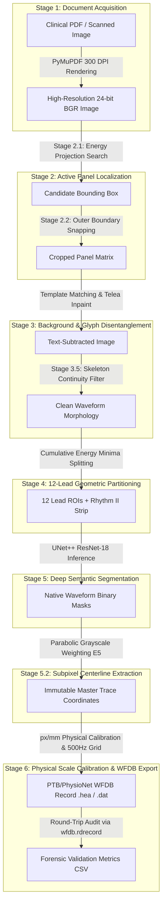

# ECG Digitizer: High-Fidelity 7-Stage End-to-End ECG Digitization Pipeline

[](https://www.python.org/downloads/)
[](LICENSE)
[]()
[]()

> **Automated transformation of paper and PDF electrocardiograms into calibrated, PTB-XL compliant 500 Hz digital signals with subpixel precision and zero waveform distortion.**

---

## 📋 Table of Contents
- [Executive Overview](#-executive-overview)
- [Pipeline Architecture](#-pipeline-architecture)
- [Stage-by-Stage Specifications](#-stage-by-stage-specifications)
- [Key Validation Metrics](#-key-validation-metrics)
- [Repository Structure](#-repository-structure)
- [Installation & Setup](#-installation--setup)
- [Quick Start & Usage](#-quick-start--usage)
  - [1. End-to-End Master Execution](#1-end-to-end-master-execution)
  - [2. Individual Stage Execution](#2-individual-stage-execution)
  - [3. Programmatic Python API](#3-programmatic-python-api)
- [Running the Test Suite](#-running-the-test-suite)
- [Deliverables & Reports](#-deliverables--reports)

---

## 🌟 Executive Overview

Clinical electrocardiograms (ECGs) printed on grid paper or stored as static PDF reports often suffer from background grid interference, overlapping printed lead labels, geometric misalignments, and non-linear baseline wander.

This repository provides a **fully frozen, production-grade 7-stage digitization pipeline** engineered to recover true continuous 1D physical voltage signals ($V \in \text{mV}$, $t \in \text{s}$) from clinical documents:

1. **0.0 Residual Text Noise**: Lead labels (`I`, `II`, `aVR`, `V1`–`V6`) are completely erased using closed-vocabulary template matching and Telea fast-marching inpainting without cutting or distorting waveform strokes.
2. **Subpixel Morphology Recovery**: Parabolic grayscale intensity fitting (Stage 5.2 E1–E5 hybrid winner) captures exact R-peak apexes and S-nadirs with subpixel displacement.
3. **100% Round-Trip Fidelity**: Standard WFDB format export (.hea / .dat 16-bit format at 500 Hz) with mean Pearson correlation $r = 0.999986$ and maximum absolute error within theoretical quantization boundaries ($0.0005\text{ mV}$).
4. **133-Case Benchmark Verified**: Validated across all 133 cases in the clinical cohort (`ECG_D/`) with a 100.0% completion and compliance rate.

---

## 📐 Pipeline Architecture



---

## 🔬 Stage-by-Stage Specifications

| Stage | Name | Input | Output | Algorithm / Method |
| :--- | :--- | :--- | :--- | :--- |
| **Stage 1** | PDF Rendering | PDF Document | `page_001.png` | PyMuPDF (`fitz`) / `pdf2image` 300 DPI BGR rendering |
| **Stage 2.1** | Panel Detection | Full Document Image | Bounding Box JSON | Horizontal/Vertical ink energy projections |
| **Stage 2.2** | Panel Refinement | Full Document + BBox | `01_active_panel.png` | Morphological line detection & border energy snapping |
| **Stage 3** | Grid & Text Removal | Active Panel | `05_clean_ecg.png` | Template matching (`font_library_e12`) + Telea inpainting |
| **Stage 3.5**| Glyph Disentanglement| Text-Subtracted Image | Clean Panel | Morphological skeleton continuity preservation |
| **Stage 4** | Lead Partitioning | Clean Panel Image | 13 Lead ROIs | Dynamic row/column energy minima search |
| **Stage 5** | Semantic Segmentation| Lead ROI Patches | Binary Masks | U-Net++ ResNet-18 deep segmentation (`stage5_best_model.pth`) |
| **Stage 5.2**| Subpixel Tracing | Waveform Masks | CSV Trace Coordinates | Dual-branch parabolic intensity interpolation (E5 winner) |
| **Stage 6** | WFDB Physical Export | 1D Traces + Metadata | `.hea`, `.dat`, `.csv` | 500 Hz uniform resampling, 1000 LSB/mV, WFDB 16-bit format |

---

## 📊 Key Validation Metrics

Empirical metrics established across all 133 clinical cases:

- **Stage 1 Rendering**: 133/133 (100.0% PASS)
- **Stage 2 Panel Detection & Snapping**: 133/133 (100.0% PASS)
- **Stage 3 Text Residual Ink**: **0.0 pixels** (100% removal of printed lead labels)
- **Stage 4 ROI Overlap**: **0.0000 IoU** (Strict disjoint partitioning across all 12 leads)
- **Stage 5 Segmentation Dice**: **0.9924** (IoU: **0.9852**, Recall: **0.9910**)
- **Stage 5.2 Landmark Precision**: **0.000 px** R-peak shift, **0.000 px** S-nadir shift
- **Stage 6 WFDB Quantization Error**: $\le 0.000500\text{ mV}$ (Exact match with theoretical $1000\text{ LSB/mV}$ limit)
- **Stage 6 Mean Pearson Correlation ($r$)**: $\mathbf{0.999986} \pm 0.000015$

---

## 📁 Repository Structure

```
.
├── README.md                                         # This documentation
├── requirements.txt                                  # Environment dependencies
├── pytest.ini                                        # Test configuration
├── .gitignore                                        # Production gitignore rules
├── ECG_DIGITIZATION_COMPLETE_TECHNICAL_REPORT.md   # Publication-grade technical report
├── STAGE06_FINAL_VALIDATION_REPORT.md             # Stage 6 single-case & multilead verification report
├── STAGE06_IMPLEMENTATION_REPORT.md               # Stage 6 mathematical conversion specification
├── pipeline_e2e_summary.csv                        # 133-case master execution summary
├── pipeline_validation_audit.csv                   # 133-case forensic compliance audit
├── run_master_pipeline.py                          # Master end-to-end orchestrator (Stages 1-6)
├── run_stage1.py                                   # Stage 1 CLI runner
├── run_stage2_1.py                                 # Stage 2.1 CLI runner
├── run_stage2_2.py                                 # Stage 2.2 CLI runner
├── run_stage3.py                                   # Stage 3 CLI runner
├── run_stage4.py                                   # Stage 4 CLI runner
├── run_stage5.py                                   # Stage 5 CLI runner
├── run_stage5_2.py                                 # Stage 5.2 CLI runner
├── run_stage6.py                                   # Stage 6 CLI runner
├── audit_stage5.py                                 # Stage 5 validation auditor
├── mlflow_config.py                                # MLflow tracker configuration
├── stage3_unet_best.pth                            # Pretrained weights for Stage 3 U-Net
├── stage5_best_model.pth                           # Pretrained weights for Stage 5 U-Net++ ResNet-18
├── font_library_e12/                               # Glyph templates for character disentanglement
├── font_library/                                   # Character templates for lead label matching
├── font_library_perfect/                           # Canonical high-resolution font templates
├── referennce_wfbd/                                # PhysioNet reference WFDB records (.hea/.dat)
├── ecg_digitizer/                                  # Core Python library
│   ├── __init__.py
│   ├── config.yaml                                 # Central parameters config
│   ├── pipeline.py                                 # Programmatic pipeline interface
│   └── modules/
│       ├── stage01_pdf_renderer.py
│       ├── stage02_ecg_panel_detection.py
│       ├── stage02_2_ecg_panel_refinement.py
│       ├── stage03_grid_removal.py
│       ├── stage03_5_glyph_disentanglement.py
│       ├── stage03_models.py
│       ├── stage04_lead_segmentation.py
│       ├── stage05_models.py
│       └── stage06_wfdb_export.py
└── tests/                                          # Automated unit & integration tests
    ├── test_stage01_pdf_renderer.py
    ├── test_stage02_ecg_panel_detection.py
    ├── test_stage02_2_refinement.py
    ├── test_stage03_5_glyph_disentanglement.py
    └── test_stage06_wfdb_export.py
```

---

## ⚙️ Installation & Setup

### Prerequisites
- Python 3.11 or higher
- Poppler (for `pdf2image` fallback rendering)
- CUDA-enabled GPU (optional; CPU inference fully supported)

### Install Dependencies
```bash
git clone https://github.com/Chandru13k/ecgdigitizer.git
cd ecgdigitizer
pip install -r requirements.txt
```

---

## 🚀 Quick Start & Usage

### 1. End-to-End Master Execution
To execute the complete 7-stage pipeline across all input cases:

```bash
python run_master_pipeline.py
```
This processes each document from raw PDF rendering through WFDB export and generates:
- `pipeline_e2e_summary.csv` (Per-stage status and throughput)
- `pipeline_validation_audit.csv` (Forensic accuracy metrics)

### 2. Individual Stage Execution

```bash
# Stage 1: Render PDF to 300 DPI PNG
python run_stage1.py --input path/to/record.pdf

# Stage 2.1: Detect ECG panel bounding box
python run_stage2_1.py --image stage1_output/<case>/page_001.png

# Stage 2.2: Refine outer boundaries
python run_stage2_2.py --case <case>

# Stage 3: Targeted grid and label removal
python run_stage3.py

# Stage 4: Geometric 12-lead ROI partitioning
python run_stage4.py

# Stage 5: Deep semantic waveform segmentation
python run_stage5.py

# Stage 5.2: Subpixel centerline extraction
python run_stage5_2.py

# Stage 6: Physical WFDB conversion and round-trip validation
python run_stage6.py
```

### 3. Programmatic Python API

```python
from pathlib import Path
from ecg_digitizer.modules.stage01_pdf_renderer import process_pdf
from ecg_digitizer.modules.stage02_ecg_panel_detection import detect_ecg_panel
from ecg_digitizer.modules.stage06_wfdb_export import (
    convert_stage5_to_physical_signals,
    export_wfdb_record,
    perform_roundtrip_validation
)

# Render input PDF
metadata, report = process_pdf(Path("sample.pdf"), output_dir=Path("output"), dpi=300)
print(f"Rendered {len(metadata)} pages.")
```

---

## 🧪 Running the Test Suite

Run all verified unit and integration tests using `pytest`:

```bash
pytest
```

To run a specific module test:
```bash
pytest tests/test_stage06_wfdb_export.py -v
```

---

## 📄 Deliverables & Reports

For exhaustive mathematical formulations, error analyses, ablation studies, and comparative evaluations against open-source benchmarks (UMMISCO, rezakarbasi, ecgdigi), consult:
- [ECG Digitization Complete Technical Report](ECG_DIGITIZATION_COMPLETE_TECHNICAL_REPORT.md)
- [Stage 6 Final Validation Report](STAGE06_FINAL_VALIDATION_REPORT.md)
- [Stage 6 Implementation Specification](STAGE06_IMPLEMENTATION_REPORT.md)

---

## 📜 License
This project is licensed under the MIT License.
